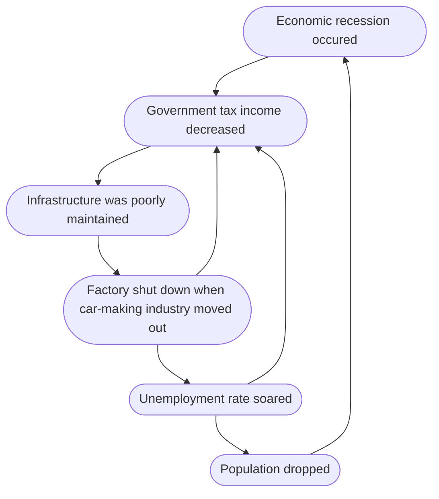
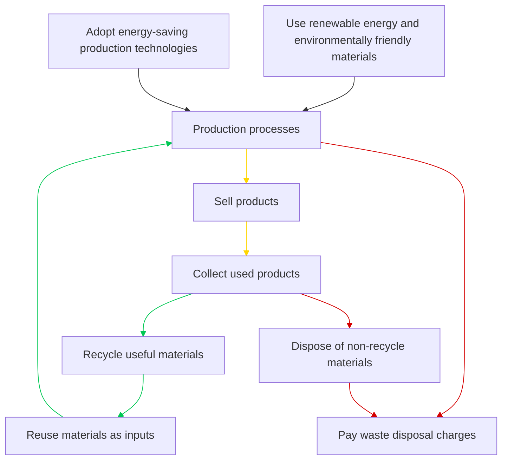

##### 1.1 What is industry

- -> Economic activities

Types

- **Primary industry**
  
  - Extracting and obtaining **resources**

- **Secondary industry**
  
  - turning raw materials into (semi-finished) **products**
  - **manufacturing industry**

- **Tertiary industry**
  
  - **provides services for customers or other industries**
  - e.g. retail, banking

- **Quaternary industry**
  
  - **R&D** (research and development)

##### 1.2 Manufacturing industry

Manufacturing system

- Input
  
  - **Physical input**
  
  - **Human input**

- Process(es)

- Outputs
  
  - **Useful outputs**
  
  - **Useless outputs**
  
  - -> **Investment** -> input

Types

- Weight
  
  - **Light industry**
    
    - e.g. Electronics
  
  - **Heavy industry**
    
    - e.g. Iron and steel

- Labour / Capital
  
  - **Labour-intensive industry**
    
    - e.g. Garment
  
  - **Capital-intensive industry**
    
    - e.g. Shipbuilding

- Technology
  
  - **Low-tech industry**
    
    - Plastic industry
  
  - **High-tech industry**
    
    - IT industry

##### 1.3 Choice of Industrial locations

**Physical factors**

- **Land**
  
  - Important to heavy industries
  
  - -> **Coastal areas**
    
    - extensive **cheap and flat land**
    
    - Can carry out **reclamation**

- **Energy**
  
  - **Power-oriented industries**
    
    - locate close to **energy sources**
    
    - or with stable and **cheap power supply**

- **Raw material**
  
  - **Raw material-oriented** industries
    
    - Use **bulky / perishable raw materials**
    
    - located near the sources to **reduce transport costs**
    
    - e.g. Sugar from sugar cane

**Human factors**

- **Labour**
  - Labour intensive industry: Densely populated area -> **cheap labour**
  - High-tech industries: Near universities -> **well educated R&D professionals**
- **Transport**
  - Good **transport network** (e.g. highways, railways, container terminals, airports)
- **Market**
  - Transport **bulky / fragile goods** -> market orientated industry
  - located near the market
- **Government policies**
  - Provide manufacturers with **incentives**
  - ->    boost **industrial development**
  - e.g. low-interest loans, favourable tax rates, good infrastructure

##### 2.1 Manufacturing in Hong Kong

- Started in **1950s**

- 1970s: **light and labour intensive industries** grew rapidly and peaked

- **Small** in scale, mainly for export

Distribution

- Along **both sides of Victoria harbour**

- Expanded to **urban fringe** and **new towns**

Stages

- 1950s
  
  - **Chinese immigrants** = labour
  
  - **Textile and plastic industry**
  
  - Found along **Victoria harbour (Hung Hom)**

- 1960s-mid1970s
  
  - **Light industries** (garment, toys, watches, clocks, electronics)
  
  - **Multi-storey factory** built on urban fringe (Kwun Tong)

- mid 1970s - mid 1980s
  
  - Industries need **larger space** (food processing, machinery manufacturing, printing)
  
  - Gov. built **industrial zones** and **industrial estates** in **new towns** (Sha Tin, Yuen Long)

- late 1990s \- present
  
  - Supports development of **high-tech industries** (ICT, AI, biotech)
  
  - **Close to universities** 
  
  - Coastal locations (**good working env**)

##### 2.2 Change of manufacturing industry of Hong Kong

- **Relocated** from Hong Kong to **ZDR(Zhujiang Delta Region)**

- then moved further away to **Cities in Guangdong**

Production Mode

- **Single-point production mode**
  
  - Both headquarters and factories: same place

- **Multi-point production mode** / 'front shop, back factory' production mode
  
  - **Headquarters** in Hong Kong: Management, product design, marketing, logistics
  
  - **Factories in ZDR**: production, assembling, packaging

Decline in importance

- **Less important to Hong Kong's economy**

- GDP decreased from 30% (1970) -> 1% (2020)

- % of people employed also declined

- **Tertiary industry** became the most important

##### 2.3 Push and pull factors

- **Push factor**: motivate industries to leave

- **Pull factor**: encourage industries to move in

**Wage**

- Hong Kong: **Rising wages** -> increased production **costs**

- **Large population in ZDR** -> abundant supply of **cheap labour**

- Reduce production costs

**Rent**

- Hong Kong
  
  - **Land supply limited** -> **High rents**
  
  - **Multi-storey factory building still expensive**

- ZDR
  
  - **Extensive flat land** at lower costs -> larger factories at **lower costs**

**Government support**

- HK: **non-intervention policy** -> **lacked support** and incentives

- Chinese Government
  
  - **Special Economic Zones in Shenzhen** in 1978 during economic reforms
  
  - **Incentives offered** to attract Hong Kong manufacturers to invest in ZDR

**Pollution control**

- Hong Kong
  
  - Strict
  
  - Required sewage facilities

- ZDR
  
  - **Loose**
  
  - Not required
  
  - -> Lower production costs

#### 3 Global Shift of Manufacturing

##### 3.1 Industrial belt

- Where **traditional industrial regions cluster**

- Found in **mid-latitudes** of the northern hemisphere

- Spans **Europe**, **East Asia**, **North America**

- Heavy industries (iron and steel) are major types of manufacturing activities

- Light industries (textile) are less

Europe

- **United Kingdom**
  
  - **Industrial revolution**
  
  - Textile and iron and steel industry thrived
  
  - Spread to other part of Europe (Ruhr Region in Germany)

- **Eastern Europe**
  
  - St. Petersburg, Russia
  
  - Spread to Moscow, Ukraine

- **Japan, Korea, China**: **traditional industrial centres** in East Asia
  
  - Eastern coast of Kanto Plain in Japan (Tokyo)
  
  - Seoul and Busan in Korea
  
  - **Three Northeast Provinces** and **Beijing-Tianjin Region** in China

- **North America**
  
  - **Great Lakes Region**: **iron and steel**, **car making**

##### 3.2 Locational factors for industrial belt

Physical

- Large area of **cheap and flat land**

- Cities along are **rich in natural resources** -> **raw materials** and **energy resources**

Human

- **Big cities** nearby -> **markets**, **capital** and **labour**

- **Good transport network** and **facilities** e.g. railways and ports

- Carry out **policies that support industrial development**

- **Agglomeration economies**
  
  - Similar industries **cluster in an area**
  
  - **Share infrastructure**
  
  - **Save production costs** (shipbuilding factories **buy steel in bulk for low costs** from **steel plant nearby**)
  
  - **Supporting services** are bought in (**banking**, **insurance**)
  
  - **Workers with different skills** are attracted

- **Industrial inertia**
  
  - Even if locational advantages are lost industries stay because:
    
    - **stable and availability of markets**, **facilities** and **labour**
    
    - Reduced **risk of relocation**

##### 3.3+3.4 Global Shift of Manufacturing

- Industrial belt have relocated to new industrial regions

New industrial regions

- Low-skilled production process moved from 
  
  - More developed countries (MDCs) to
  
  - Less developed countries (LDCs) e.g. Southeast Asia, Central America
  
  - **New industrial regions** emerged

Change in manufacturing output value

- LDCs undergone **rapid industrial development**

- -> LDCs **share in global manufacturing output** **increased** significantly

- MDCs declined, some MDCs **experience industrial decline**

- China has been the **fastest growing nation**

- Overtook everyone else and **became the 'world factory'**

###### Causes

**Technological advancement**

- Overcame **geographical barriers**

- Save production time

- -> Increases mobility of goods and people

- Transport
  
  - Good transport facilities -> reduce costs
  
  - e.g. **Modern container ships** have a large capacity
    
    - Transport **bulk amount at low costs**
    
    - -> heavy industry **not bounded by source of raw material and energy**
  
  - **Air transport** 
    
    - **fast** means to ship products
    
    - Allows people to **travel between places easily** -> **manage business**

- **Production technologies**
  
  - Give industries more **freedom**
  
  - Steel plant can **reuse scrap iron** -> can be located **further from iron mines**
  
  - Refrigeration and preservation tech -> **food processing** can be **located further from market**
  
  - Breakthroughs in ICT (email, video conferences) -> speed up **information exchange between headquarters and regional offices**

- **Labour cost reduction**
  
  - LDCs have abundant supply of **cheap labour** -> attract many labour intensive and low tech industries
  
  - Wages of **well-educated professionals** are **cheaper** in LDCs -> high-tech companies set up R&D centres in India

- **Market reduction**
  
  - LDCs undergone **rapid economic development**
  
  - -> **Demand of consumer goods** increase
  
  - Become **new markets for manufactured products**

- **Political considerations**
  
  - **Favourable policies**
    
    - LDCs set up **industrial parks**
    
    - Provide manufacturers with various **economic incentives** 
    
    - (**Lower tax rates**, **priority in power supply**, **relaxed pollution control politics**)
  
  - **Reduction of trade barriers**
    
    - Countries **impose tariffs or quotas on imported goods** -> protect local industries
    
    - -> foreign companies set up **factories in these countries** to **reduce trade barriers**
    
    - Nike **set up factories and retail stores in LDCs** -> **trade barriers are overcome**

- -> TNCs (transnational corporations) play **important part in global shift of manufacturing** 

##### 3.5 Role of TNCs in Global Shift of Manufacturing

- Transnational corporations (TNCs): have **factories** and **offices** **in many countries**

production mode

- **Multi-point production mode** by **division of labour**
  
  - Headquarters are **located in MDCs** (home countries)
  
  - **Regional offices** and **R&D centres**: other **MDCs**
  
  - **Factories**: **LDCs** (host countries)
  
  - Through FDI (**foreign direct investment**)
  
  - Responsible for **low-skilled prod process** such as **assembling**

- Case: Nike
  
  - TNC based on Oregon, USA
  
  - Moved factories to **Japan, Korea and Taiwan**
  
  - increasing production costs 
    
    - -> further relocated to **other LDCs where labour costs are lower**
    
    - e.g. **Thailand**, **China** and **Vietnam**

- **Advantages**
  
  - Allows TNCs to **make good use of locational advantages** -> reduce prod **cost** + expand **markets**
  
  - Promotes **global capital flow** and **technology transfer** -> boosts **industrial development of LDCs**

##### 4.1+4.2 Impacts of Global Shift of Manufacturing

###### On MDCs

Benefits

- **More tax income**
  
  - **Relocating factories** -> **cost saving**, **market expansion** -> more **profit**
  
  - -> Home countries can **collect more taxes from MDCs**

- **Cheaper products**
  
  - **Lower production costs** -> Sell products at **cheaper prices** 
  
  - **Local firms** will also **lower the prices of their products**
  
  - -> Consumers can **enjoy cheaper goods**

- **Reduced industrial pollution**
  
  - the **Environment improves**
  
  - -> Emission of **air pollutant** in USA have halved since 1990s

- e.g. Silicon valley
  
  - 1940s: Silicon Valley was a manufacturing centre of semi-conductors -> use of chemicals -> **severe water pollution**
  
  - 1980s: Pollution water may have **caused birth defects and cancer**
  
  - Today: TNCs have **moved their factories to Asia** -> **Water quality improved**

Challenges

- **Competition with local industries**
  
  - Products made in LDCs are **generally cheaper** -> Industries face **strong competition** 
  
  - -> Local companies may **have to shut down**

- **Unemployment**
  
  - Workers lose their job **when factories relocate**
  
  - -> Workers with **low level of education** and **skills** find it **difficult to shift to tertiary industry**
  
  - -> **Unemployment rate rises** 
  
  - -> **Social problems** (e.g. **Crime rate increase**, **poverty**, Drug abuse, Alcoholism)

- **Decay of Industrial areas**
  
  - Factories **close down and left abandoned** -> Traditional industrial area **begin to decay**
  
  - Factories and facilities nearby are **old and worn out**
  
  - Poorly maintained buildings **pose danger to people**
  
  - **Environment worsens** and **visual pollution** arises
  
  - **Industrial production stopped** and **local development slowed down**
  
  - e.g. **Detroit home to several car manufacturers** -> Move **production lines out of Detroit**
    
    - -> **Former factories fell into disuse**

- **Economic recession**

- **Factories shut down** -> **Jobs are lost** -> **People leave** (population decrease)

- **Economic development show down**, **government receives less tax income** (-> **Poorly maintained infrastructure**)

- -> **Vicious cycle between economic recession and urban decay**

- e.g. **Detroit government** went bankrupt due to relocation of car factories

###### On LDCs

benefits

- More job opportunities
  
  - -> **Secondary industry grows** -> important economic sector
  
  - Coca-Cola created 25 000 direct jobs and 150 000 Indirect Job in India
  
  - -> Factory workers earn a higher income -> improved standards of living

- Faster economic growth
  
  - Increased income level -> More tax income -> improve infastructure
  
  - -> Attract more foreign investments, promote the growth of other industries 
  
  - **Multiplier effect** (like a rolling snowball)

- Technology transfer
  
  - TNCs **introduce new production technologies** to LDCs 
  
  - -> raises **skill level of local workers**
  
  - -> **Boost** the **industrial development of LDCs** on the whole

Challenges

- **Labour exploitation**
  
  - **Lack of labour legislation** and **protection**
  
  - -> **Low wages**, **long working hours**, **poor working environment**, **child labour**: **Sweatshops**

- **Low profits**
  
  - LDCs: Responsible for **low-tech** and **low-value-added** manufacturing process -> bring **very low profits**
  
  - e.g. USA takes more than half total profit in Apple tablet

- **Competition with local industries**
  
  - TNCs tend to be **more competitive** when entering markets of LDCs
  
  - Have **more capital**, **more technologies**, better **marketing strategies**
  
  - e.g. India soft drink market controlled by two TNCs

- **Environmental protection**
  
  - LDCs: **Loose pollution control policies**
  
  - -> **Polluting industries relocate there** (e.g. **electroplating**, **bleaching**, **dyeing**)
  
  - -> Produce **large amount of sewage**, **toxic chemicals** and **wastes** 
  
  - -> Harmful to both **natural environment** and **human health**

##### 4.3+4.4 Tackling challenges

**MDCs**

- Move towards **High-tech industries**
  
  - Promote **industrial restructuring** (offering **subsidises**, **lower tax** rates, **cheap land**)
  
  - -> Help traditional manufacturing **move towards high-tech industries**
    
    - e.g. **iT industry**, **medicine manufacturing**, **aerospace technology**
  
  - **Characteristics**
    
    - **Locations are not limited by traditional locational factors**
    
    - Involves **advanced technology**
    
    - Focus on **R&D of products**
    
    - **Capital-intensive** (**invested in R&D**, **buying machinery**, **hiring professionals**)
    
    - High-value added industries (produce high-end and profitable products)

- Developing the **tertiary industry**
  
  - e.g. **Tourism**, **finance**, **retailing**
  
  - -> **Diversify economic structure**, **promote economic growth**
  
  - -> Provide **job opportunities** for **former manufacturing workers**

- **Supporting unemployed workers**
  
  - **Unemployed benefits** -> maintain a basic standard of living
  
  - **Job matching services** -> find new jobs
  
  - **Retraining programmes** -> New skills so they can work in other industries

**LDCs**

- **Improve labour protection**
  
  - **Pass new laws** to **protect labour welfare** and **rights**
  
  - e.g.
    
    - Setting up a **minimum wage**, **maximum working hours**
    
    - **Banning child labour**
    
    - **Inspecting fire safety equipment**
    
    - **Inspecting factories regularly** -> **safe working environment**

- Promoting **industrial restructuring**
  
  - Develop **high-value-added industries** and **services industries**
  
  - -> Reduce **reliance on traditional manufacturing**
  
  - -> **Diversify the economy**
  
  - Countries **invested large amounts of capital and technology in R&D**
  
  - -> enhance **productivity and increase profits**

- **Building own brands**
  
  - Background: **earn few profit** **from low-skilled manufacturing activities** 
  
  - Developing own brands by **improving product designs**
  
  - Enhance **competitiveness**
  
  - Increase **profits**
  
  - e.g. Lenovo and Huawei in China

- **Tightening pollution control**
  
  - Set up laws to **reduce industrial pollution**
  
  - **Tighten emission standards** of pollutants
  
  - Impose **penalties on factories that break the law**
  
  - Build **Sewage collection facilities** and **Sewage treatment plants**

##### Sustainable development

- -> Reduce **negative impacts of manufacturing activities**

- **Balancing needs of the economy**, **society** and **environment**

**Economy**

- **Increase production efficiency using technology**

- Improve **product quality** -> **promote market expansion**, **increase profits**

- **Develop different industries** -> **diversify economy**

- Maintain **stable economic growth** -> **capital for industrial development**

**Society**

- **Pass laws** (e.g. minimum wage, maximum working hours) -> **protect workers**

- Create a **safe working environment**

- **Ban child labour**

- Provide workers with **training** -> **raise level of skills**

- Protect workers' right to **form trade unions**

Environment

- Increase use of **renewable energy**

- Use **environmentally friendly methods** to obtain raw minerals and energy

- Adopt **energy-saving production technologies** -> **reduce pollution**

- Carry out the **polluter-pays principle** (collect **sewage charges** from producers)

- Promote **extended producer responsibility** -> encourage producer to **collect, recycle and dispose of** used products

In practice

- Business
  
  - **Increase energy efficiency**
  
  - Adopt **environmentally friendly production methods**

- **Industrial area**
  
  - **Share infrastructure** and **inputs** (e.g. **energy**, **raw materials**)

- **City**
  
  - Promote **waste recycling**, **environmental industries** and **green technologies**

Extended producer responsibility:

