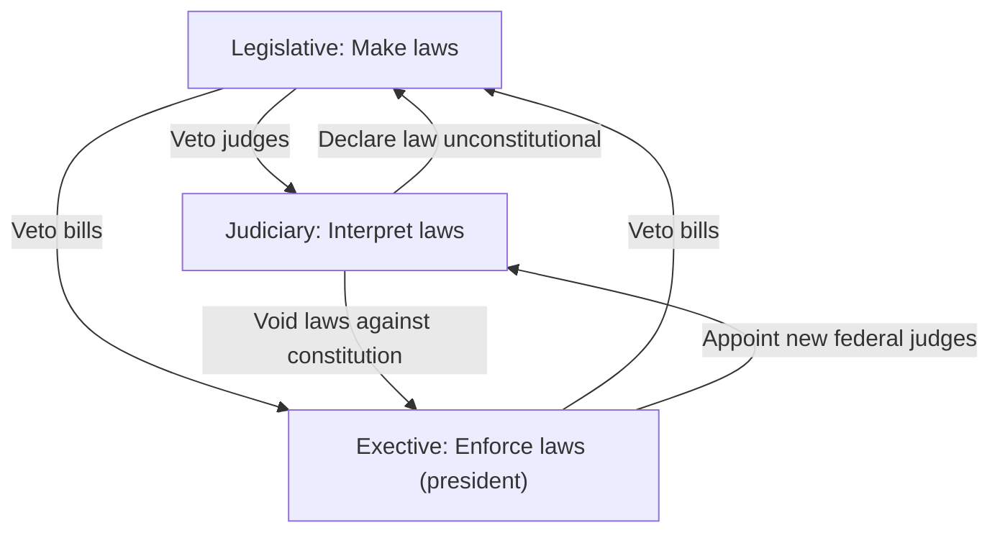

### French revolution

- 1789-1799

- Enlightenment idea

- -> **Nationalism**

- Influential

Background

- 16 century: **Bourbon Dynasty** absolute rule

- **Louis XVI (16)**: 
  
  - **Political corruption**
  
  - **financial** + **social crisis**

#### Causes

- **Political corruption**
  
  - Lived **extravagant life**
  
  - Failed to solve **worsening financial and social problems**

- **Social inequalities**
  
  - Three estates
    
    - **First Estate** (**clergy**)
    
    - **Second Estate** (**nobility**)
    
    - **Third Estate** (**commoners**)
  
  - **First, Second**: 
    
    - **Minorities**
    
    - **Held gov. posts**
    
    - **had land**
    
    - **lived luxuriously**
    
    - **Did not pay taxes**
  
  - **Third**: 
    
    - **Bottom of society**
    
    - Including **rich and educated merchants**, **doctors** and **lawyers**
    
    - **Did not have say** in **government**
    
    - shoulder **heavy tax burdens**
  
  - -> **discontent** among the Third estate

- **Financial crisis**
  
  - Prev kings **fought too much wars**
  
  - **Louis** XVI (**16**) **sent troops to American Revolution**
  
  - **Court lived luxuriously**
  
  - **Natural disasters** -> **tax income greatly reduced**
  
  - -> **FORCED** to call a meeting of the **Estates-General**: **Immediate cause** of French Revolution

- Inspiration
  
  - **Enlightenment**
    
    - **Liberty, equality and civil right** promoted by **Enlightenment thinkers** (**Montesquieu**, **Voltaire** and **Rousseau**)
    
    - Deepened the **discontent against social inequalities**
    
    - -> **challenge absolutism**
  
  - **American Revolution**
    
    - **Soldiers shared their experience**
    
    - Bought the **ideas of equality and liberty**
    
    - Encouraged **French people to fight for their rights**
    
    - **End absolutism** and **social inequalities**

#### Course of Revolution

- Immediate cause
  
  - **Social instability**
    
    - **Food scarcity** -> **inflation**
    
    - **People fled to Paris** -> **Competition for food and jobs** -> **social instability**
  
  - Calling of **Estates-General**
    
    - Discuss **tax reform**
    - Third estate proposed changing existing **voting system** to **'One Head, One Vote'**
    - **Opposed** by First and Second Estate
    - -> Withdrew from the Estates-General and set up **National assembly**
    - -> **Protest** against **unequal treatment**
  
  - Tennis court oath
    
    + **Louis XVI Close meeting hall** -> Met at **tennis court**
    + Took the **Tennis Court Oath**
      * **Would not disband** until Louis XVI introduced **a constitution**
      * **Political power** belonged to **the people** and **their representatives**

- (not examined) Outbreak of the Revolution 
  
  - Fall of Bastille (begin of revolution)
    
    - Heard government intended to suppress them -> attacked **the Bastille** to seize weapons
  
  - **Declaration of the Rights of Man and of the Citizen**
    
    - Born free and equal
    
    - Enjoy freedom of speech, the press, religion
    
    - Power of government comes from the people

- Development and end of Revolution
  
  1. **Constitutional monarchy**
  2. **Republic**
  3. European countries **attacked France in order to end it** -> **French Revolutionary Wars**
  4. **Napoleon** absolute rule: End of French revolution

#### (not examined) Napoleonic Era

Rise of Napoleon

- Suppressed revolts and defended France against foreign invasion  
- Became a national hero  
- **1799:** Set up the *Consulate* and became the *First Consul*  
- **1802:** Made Consul for life  
- Reforms
  - Ended privileges of nobles and clergy  
  - Abolished serfdom (feudal system) and gave land to farmers  
  - Built schools and universities  
  - Introduced a new tax system to increase revenue  
  - Introduced **Code Napoleon** to guarantee by law the rights of people as stated 

Rise and fall of the First French Empire

- 1804: Napoleon ended the republic -> the First French Empire
- 'Napoleonic Wars'
  - Continuously at war with other European countries
  - Aggressive
- Won many war -> became the master of Europe
- 1808 France lost serveral wars
- 1815 Defeated by anti-French coalition -> exiled to **St. Helena** (end of Napoleonic era)

#### Influence

(not examined) Rise of liberalism and nationalism

- Nationalism
  - People with common history, religion, language, customs 
  - -> should join together and govern themselves
  - Should not controlled by other ethnic group or countries
- Liberalism
  - Born free and equal
  - Should enjoy a life of freedom
  - Have the right to overthrow an absolute government
- Spread in France
  - Liberalism
    - 'Liberty, Equality and Fraternity': Slogan of French revolution
    - Liberalism took root in France
    - Code Napoleon guaranteed people's civil liberties
    - -> Liberty became unshakeable 
  - Nationalism
    - French Revolution gave birth to nationalism
    - People joined together to defend the revolution and their country
    - Dominated Europe -> proud of their country 
    - Nationalism became a strong force
- Spread in Europe
  - Liberalism
    - Napoleon overthrew many absolute rulers and introduced liberal reforms
    - -> Liberalism spread across Europe
  - Nationalism
    - Encouraged people to fight for national liberation -> nationalism
    - After: Nationalist revolution and unification took place

**Rise of revolutionary tide**

- Europe
  - **Congress of Vienna**
    - Because French Revolution shook the **political and social order** of Europe
    - Wanted to **restore old order of Europe**
    - **Prevent French expansion** in the future
    - **Stop the spread of nationalism** and **liberalism**
    - **Restored the dynasties**
    - **Redrew the map**
    - Formed the **Holy Alliance** (**Russia**, **Prussia**, **Austria**) to **maintain absolute rule**
  - **Revolutions**
    - Congress of Vienna **Ignored rising force of nationalism** and **liberalism** 
    - -> Revolutions **broke out between 1820-1840**
    - forced rulers to **make concessions**
      - **Constitutional rule**
      - **Granted people freedoms**
      - **Unified Italy and Germany**
- **American**
  - Spread to Americas
  - **Independent movement** broke out in **Central and South America**
  - **Get rid of absolute rule** and **set up nation-states** -> **Mexico** and **Chile**

(not examined) Creation of Unified nation states

- Nationalism taken root
- Unification movement in Italy
  - Led by Kingdom of Sardinia
  - Defeated Austria with help of France -> took over some territories
  - Took over certain central Italian states
  - The Red Shirts captured Kingdom of the Two Sicilies -> Kingdom of Italy
  - Help Prussia defeat Austria -> took over northern territory
  - Captured Rome after France -> Rome became capital
- Unification movement in Germany
  - ......

### European colonial expansion

- Early Expansion
  - Early **16th to Late 18th centuries**
  - **Old Imperialism**
  - Following **Voyages of discovery**
  - **Asia**, **Africa**, and (**mainly**) the **Americas**
  - **Portugal, Spain, the Netherlands, Britain, France**
  - Discover of **new sea route** and new lands
  - To **expand territories, trades**
  - To **plunder local resources**
  - To **spread Christianity** and **pursue religious freedom**
- **Later Colonial expansion**
  - Late **19th to early 20th centuries**
  - **New imperialism**
  - **Asia and Africa** (America declared **Monroe Doctrine**)
  - Most of **Africa and Southeast Asia became European colonies**
  - by **Britain, France, Germany, Italy**
  - Ambition **enhanced by early colonial expansion**
  - **Supremacy of European countries**
  - **Limited room for territorial expansion in Europe**, **Development of nationalism**
  - Strong demand for resources and markets, huge population and resources in Asia and Africa
  - Idea of the **White men's burden**

###### Early expansion

(not examined) Background

- Voyages of discovery
- Diaz: Sailed directly from Western Europe to India
- Columbus: Reached present-day West Indies
- Magellan: First global circumnavigation

Reasons

- **Political**
  - Strong kings **wanted to expand to increase territories** and **economic power**
- Economic
  - **Mercantilism**: **accumulation of wealth**
  - -> sped up **oversea expansion** to **develop trades** and **exploit local resources**
- Social + cultural
  - Expand overseas to **spread Christianity**
  - Pursuit of **religious freedom**
  - e.g. **Puritans** became early colonists in North America

###### Later expansion

- More **ambitious and powerful** -> started a **new wave of colonial expansion** and actively built colonies in Asia and Africa

Background

- **Ambition enhanced** by **early colonial expansion**
  
  - Competed to **build overseas trading footholds** and **colonies**
  
  - -> **European-centred world trading system** was formed
  
  - **Economic exploitation** -> **Wealth** -> More **ambitious to expand overseas**
  
  - **Existing footholds became bases**

- **Independence of colonies** in the **Americas**
  
  - US declared '**Monroe Doctrine**': **No longer be regarded as targets of colonisation**
  
  - -> Sought to **build new colonies in Asia and Africa** after losing them

- **Supremacy of European countries**
  
  - Technological and military **strength increased**
  
  - Traditional Asian power (e.g. China, India) **began to decline**
  
  - Southeast Asian and African countries are **weak**
  
  - **Difference in national power** -> **ambition** to expand into **Asia** and **Africa**

Main reasons

- Economic
  
  - Strong **demand for resources and markets**
    
    - **Industrial revolution** -> **find raw materials**, **markets** and **investment opportunities** **overseas**
    
    - Expanded **colonial rule** to **develop and consolidate economic interests**
  
  - **Huge population and resources** in Asia and  Africa
    
    - **Cheap labour and raw materials** (e.g. **Cotton** in India, **Copper and diamonds** in Africa)
    
    - -> fuelled European **ambitions to scramble for Asia**

- Political
  
  - **Limited room for expansion** in Europe
    
    - Nationalist revolutions -> Germany and Italy were unified
    
    - **Map of Europe largely took shape** -> **limited room to expand** -> **expanded abroad**
  
  - **Rise and development** of **nationalism**
    
    - **Nationalism** arose in Europe
    
    - Advocated national independence and **gaining national wealth and glory** **by overpowering others**
    
    - -> Urged to **speed up aggression against others**
    
    - Carried out **colonial expansion** to gain **national glory** and **enhance international influence**

- Social and cultural aspects
  
  - **'White man's Burden'** spread in Europe
  
  - Believed it was their **duty to educate the inferior Asians and Africans** (**non-white people**)
  
  - Some missionaries **supported overseas expansion** in order to **spread Christianity to Asia and Africa** 

#### European Colonial Policy

###### Making of policies

Early expansion

- Expanded to **increase wealth** -> focused on **trade and resources**

- Set up **colonies in Americas**

- Built **coastal footholds** to trade and exploit local resources in Asia and Africa

Later expansion

- Rising **nationalism and national power** -> greater **territorial and political ambitions**

- More concerned with **extending rules overseas**

- -> established **spheres of influence**, **protectorates** and **colonies** in Asia and Africa

###### Ways of colonial expansion

Political

- Establishing **coastal footholds**
  
  - Introduction: **Coastal bases** for European countries to expand to the interior
  
  - Sovereignty belongs to: Local rulers that **allowed Europeans to get supplies and trade**
  
  - **Chartered companies**
    
    - **Trade monopoly** in specific footholds
    
    - **Governor-generals administer**
      
      - British East India Company -> India
      
      - Dutch East India Company -> Indonesia

- Establishing **spheres of influence**
  
  - Introduction
    
    - Controlled by colonial powers with **special rights**
    
    - when they **face keen competition** or **could not establish sole control**
  
  - Sovereignty belongs to: **Local rulers** who **were forced to grant rights**
  
  - Enjoyed **exclusive rights to trade**, **build factories** and **railways**
  
  - **Britain, France, Germany, Russia** set up **in China**

- Establishing **protectorates**
  
  - Introduction: **Countries or Regions protected by European colonial powers**
  
  - Sovereignty: Local rulers who **sign treaties and lost power**
  
  - -> **suzerain-protectorate** relationship
  
  - **Ruled protectorate through local rulers** -> **reduce administrative costs** and **people's resilience**
  
  - Rulers must **follow orders of suzerains**
  
  - British e.g. Mosquito Coast (America), **Somaliland** (Africa), Maldives (Asia)

- **Establishing colonies**
  
  - Introduction: **Overseas territories** of European countries
  
  - Sovereignty: **European countries**
    
    - **Replaced existing governments**
    
    - **Appointed colonial officials** to **rule directly**
  
  - e.g. Vietnam (Asia)

Economical

- **Resources exploitation**
  
  - **Natural resources**
    
    - **Plundered natural resources** -> used as **raw materials** / **exported**
    
    - Britain: **Gold and diamonds** in **South Africa**
    
    - Spain: **Silver and minerals** in **Mexico**
  
  - **Land resources**
    
    - Built **plantations**
    
    - **Forced to grow cash crops** (**spices**, **tobacco**)
    
    - **Sold to suzerains at low prices**
    
    - e.g. **Ceylon** (Sri Lanka) grow **tea**, **America** grew **sugar cane** and **cocoa beans**
  
  - **Human resources**
    
    - Captured many **American Indians** and **imported African slaves** to **work for plantations** in Americas
    
    - -> **Atlantic slave trade**
    
    - -> **15M Africans were sold**

- Control over **colonial markets**
  
  - **Trade monopoly**
    
    - *Not allowed to* **trade directly with other**
    
    - *Not allowed to* **produce similar products exported by their suzerains**
    
    - -> protected trading interests of suzerains without being threatened by the colonies
  
  - **Using resources**
    
    - Obtained **cheap raw materials from colonies**
    
    - Sold **expensive surplus industrial products back to colonies**
    
    - Set up **factories in colonies** -> **local cheap labour** -> **make and sell products directly**

Social and cultural

- Desire to **spread religion**

- Idea of the **'white man's burden'** -> **spread their religion** and **cultures** overseas

- Measures
  
  - **Built Christian churches**, **spreading Christianity**
  
  - making **European languages the official languages** (**English**, **French**)
  
  - making **European languages** the **medium of instruction in schools**
  
  - Introducing **modern Western subjects** (**chemistry**, **geography**)
  
  - Hiring **Western-educated local people** as **civil servants**
    
    - -> More people were **attracted to receive Western education**

###### Impacts of colonial expansion

**On Europe**

- Forming a **European-centred** **world trading system**
  
  - Set up huge **colonial empires**
  
  - Exported **industrial products at high prices**
  
  - -> **promoted industrial development**
  
  - -> development of international trade **tended to satisfy their interests**

- Causing **colonial disputes** and **conflicts**
  
  - **Competition for colonies and trades** -> **conflicts**
  
  - e.g. **Americas Seven Years' War** (Britain and France **fight for control of colonies** in North America)

**On the Colonies**

Political

- **Modernisation**
  
  - Carried out **reforms** in response to European colonial expansion 
    
    - e.g. **Japan** which became a **world power after successful reforms**
  
  - European countries **introduced Western modern administrative systems**
    
    - Improved **local governance**
    
    - Western **parliamentary and Judicial systems** -> spirit of the **rule of law**
    
    - **Some colonies** (e.g. Malaysia) **kept the colonial administrative and judicial system**, after independence from colonial rule

- **Discrimination and oppression**
  
  - Characterized by **racial discrimination**
  
  - Faced **unfair political treatment**
    
    - European **colonists** had **great political power** and **appointed as major officials**
    
    - Local people **did not share real power** and could **only become junior officials**
  
  - Some adopted **high-handed policies**: Suppressed colonized people **by force**

Economic

- **Infrastructure improvement**
  
  - Improved **transport system** by building **roads**, **railways** and **piers**
  
  - e.g. India **has the fourth largest railway network** in the world **owing to British**
  
  - Many **economic activities** were also developed

- **Economic exploitation**
  
  - **Plundered natural resources**, **monopolized plantations**, **mines**, **oil wells**
  
  - **Slave trade** **reduced workforce in Africa** -> Economic development **lag behind**
  
  - Mainly **developed agriculture** and **mining**, **ignored industry** **in their colonies**
  
  - -> Hindered the colonies' **long term economic development**

- **Destruction of traditional economy**
  
  - Built **large plantations** and **forced colonies to grow cash crops** (**rubber**, **pepper**)
  
  - Sold **surplus industrial goods** to the colonies -> **decline of local handicraft industries**
  
  - Destroyed traditional **self-sufficient economy**
  
  - Greatly **reduced farmlands for growing food** -> **famines**

Social and cultural

- Improvements in **education** and **living standards**
  
  - Europeans **introduced modern education**, **Western ideas**, **science and technologies**
  
  - **Broadened the horizons** of colonized people
  
  - Built **hospitals** and **introduced telegraph systems** which **improved the living conditions**

- Problems of **plagues**
  
  - **Smallpox** and **measles** **bought by Europeans** led to **serious plagues**
  
  - **American Indians died in huge numbers** and **tribes went extinct**

- Problems of **Slavery**
  
  - Europeans started the **Atlantic slave trade**
  
  - Many African slaves were **killed during trafficking and work**

- **Changes in population structure**
  
  - Change the **ethnic composition of population** in different regions
  
  - **American Indians were nearly extinct** due to **migration** and **wars**
    
    - -> European colonists became the **majority of the population**
    
    - -> **Africans sold to the Americas** also became a **new major ethnic group**
  
  - **Asia**
    
    - Colonial rulers **imported Chinese and Indians** to **Southeast Asia as workers**
    
    - -> **Multi-ethnic societies** were also **formed in Asia**
    
    - Some **Chinese and Indians** **married Southeast Asian natives** -> **New ethnic groups**

### American Revolution

Background

- Britain set up **colonies along east coast**

- -> British migrated: Regarded North America as their **homeland**

- British rule became increasingly oppressive -> started to fight for independence

#### Causes

Political: Autonomy

- Set up **local councils**: **passed laws**, **collect taxes**, **mobilize militias**

- Ruled together with appointed **governors**

- Britain **occupied with its own affairs** -> **seldom interfered**

- Dominated **North America** after the Seven Year's War -> Tighten governance
  
  - Acts have to be **appointed by the British Parliament**
  
  - Could **veto resolutions by local councils**
  
  - Could **disband the councils**

(not examined) Economic

- Trade policy
  
  - Enforced strict regulations (since 1760s)
  
  - Couldn't produce goods similar to Britain's exported goods
  
  - Could only sell goods to Britain
  
  - -> Hindered economic development

- Tax problems
  
  - Passed several acts to tax various goods 
  
  - Refused to pay tax (did not have representation in the British Parliament)
  
  - -> Relation worsened

(not examined) Social (Enlightenment)

- European enlightenment thinkers became popular

- -> Realized they have the right to overthrow an absolute government

- Thinkers (e.g. Paine, Jefferson) strongly criticized rule

- -> Encourage colonists to resist British oppression

- Paine
  
  - Founding father Opposed tyranny, set up democratic republic
  
  - Published 'common sense'

- Jefferson
  
  - Founding leader
  
  - Major author of Declaration of Independence
  
  - Natural rights and liberty 

#### Immediate causes

**Boston tea party (1773)**

- British **allowed British East India Company** to **sell teas without paying taxes**

- -> **Hurt interests** of North American **Merchants** -> **Boycott British tea**

- -> Dressed up as America Indians
  
  - Boarded British merchant ships **at Boston**
  
  - **Threw cargoes of tea into sea** -> **Show anger** at British government

**Intolerable Acts (1774)**

- Passed **Coercive Acts** -> **strengthen control**

- Believed acts **violated their rights** -> Called them the **Intolerable Acts**

**First Continental Congress (1774)**

- Held the **first Continental Congress** in **Philadelphia**

- Sent a **petition** (request letter) to **British King George III**

- Demanded
  
  - **Abolishment of the Intolerable Acts**
  
  - **Independence of the Thirteen Colonies** -> Became **Thirteen States**

- Called **'Independence Day'** or **'National Day'**

#### Political system

(not examined) Constitution of the United States (1787)

- -> Federal republic

- Federal (Central) government handled national defense, diplomacy, foreign trade, currency

- State government handled state affairs

Presidential system

- President
  
  - **head of republic**
  
  - **Elected by eligible citizens**

- First president: **Washington**

**Separation of power**

(not examined) Bill of rights (1791)

- First 10 amendments to the constitution

- Protect rights for Americans
  
  - Right to life, property, a fair trial
  
  - Freedom of speech, the press, assembly, religion

#### (not examined) Impacts

Promoting revolutionary movements

- Spread of revolutionary ideas
  
  - Put the ideas of the Enlightenment into practice (social contract, liberty)
  
  - -> Showed it was possible to achieve liberty and overthrow oppressive rule through revolution

- -> Outbreaks of revolutions 
  
  - French revolution: overthrow absolute rule
  
  - Central and South American: colonies revolted against colonial rules

Setting example of liberty and democracy

- Incorporated ideas of liberty and democracy

- -> Political structure followed by many countries

### Territorial expansion

(not examined) Background

- Recovered from American Revolution -> Rapid economic development

- Population increase

- Expanded territories through land purchases, treaties and wars

#### Course

**Louisiana Territory**: **Land purchase**

- 1800: France sized from Spain

- **Negotiated with France for purchase**

- At war with Britain -> **Sold the entire Louisiana territory**

- -> **Louisiana purchase**

- Paid 15M for 2.1M $km^{2}$

- **Territory doubled**

**Florida**: **Treaty**

- **Spain war with France** (**1807-1814**)

- -> American **migrated to Spanish West Florida**

- United States sent army to **occupy East Florida**

- -> **Spain** signed treaty with US and **ceded Florida** (1819)

Monroe Doctrine (not examined)

**Texas: Treaty**

- Declared **independence from Mexico** (**1836**) -> **Republic of Texas**

- **Agreement** -> **Admitted into the US** (**1845**)

Oregon Territory (not examined)

Mexican Cession (not examined)

**Alaska: Land purchase**

- Russian Empire **face internal economic difficulties** -> **sell Alaska** (**1867**)

- 1.5M $km^2$ of land for 7.2M USD

- -> '**Alaska Purchase**'

- Territorial Expansion in North America almost completed

Overseas territories (not examined)

#### Westward movement

Introduction (not examined)

Course 

- **Westward migration**
  
  - **Sold land in the West** (since late 18th century)
  
  - federal government passed the **Homestead Act** (1862) -> Allow people to **buy land cheaply**
  
  - -> Encouraged westward migration

- **Land development**
  
  - Opened up the **land in the West** -> built **farms** and **ranches**
  
  - **Mining + Manufacturing industry** arose (1840s - 1850s)
  
  - Government built **infrastructure**
  
  - Carried out **policies to encourage private companies to invest**
  
  - -> Many **Roads**, **Railways** and **canals** were built

- Expulsion of American Indians
  
  - Enacted the **Indian removal act**
  
  - **Expelled from their homelands** and **forced to move to Indian reservations in the West**
  
  - Many **died during migration and wars** -> **civilization seriously damaged**
