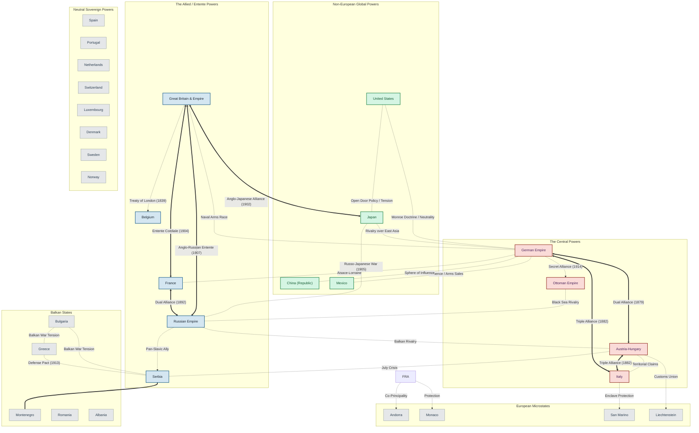

### Factors for the *First World War*

**Conflicts among European powers**

**Extreme nationalism**

- **Expand aggressively** -> Enhance status and influence at any cost

- Intensified disputes

- e.g. 

  - Germany ('Pan-Germanism') <-> France (Recapture Alsace-Lorraine, Avenge defeat in Franco-Prussian War)

  - Austria-Hungary (Suppress national independence, expand territory) <-> Russia and Serbia ('Pan-Slavism', establish 'Greater Serbia' in Balkan Penisula)

Alliance system

- Triple Alliance (Central powers)

  - Germany, Austria-Hungary, Italy (1882)

  - To isolate France

- Triple Entente (Allied powers)

  - France, Britain, Russia (1907)

- -> Divided into two rival camps, Turn into large-scale wars with chain reaction of Allies' intervention

Scrambling for colonies

- -> Conflicts

- | Incident          | Power           | Description                                 |
  | ----------------- | --------------- | ------------------------------------------- |
  | Tunisian Incident | France, Italy   | French occupied Tunisia, Italy protested    |
  | Fashoda Incident  | Britain, France | In Sudan, divided their sphere of influence |
  | Moroccan Crises   | ...             | ...                                         |

Armaments racer

- Strong military force could safeguard national security and interests

- Introduced conscription to expand armies -> Increased military expenditures

- Developed new weapons of mass destruction (e.g. machine guns)

- Built "**Dreadnoughts**" (large warships) mainly Britain and Germany

- -> Reluctant to make concessions in case of conflicts

**Pre-war Crises**

First Moroccan Crisis (1905-1906)

- **Kaiser William II** visited Morocco and declared its sovereign independence

- -> Discontent with France

- Forced to make a concession: Recognise French privileges in Morocco at last

Second Moroccan Crisis (1911)

- France sent troops to Morocco to put down riots

- Germany sent gunboats to Agadir

- -> Morocco became a French protectorate

-> Relation between Germany and France worsened

Bosnian Crisis (1908)

- Ottoman Empire was in decline

- -> Austria-Hungary annexed Bosnia and Herzegovina 

- Serbia and Russia wanted to expand -> Finally gave in bc Austria-Hungary was supported by Germany

- Serbs form a anti-Austrian organisation -> assassination in Sarajevo

Two Balkan Wars

- Ottoman Empire lost a large part of European territory

- Austria-Hungary wanted to stop Serbia from expanding 

  - -> Supported Albania's independence

  - -> Prevented Serbia from gaining access to the sea

  - -> Straining relationship

- First Balkan War

  - Balkan League (Serbia, Bulgaria, Montenegro, Greece) VS Ottoman Empire

  - Balkan states seized the European territories of the Ottoman Empire

- Second Balkan War

  - Balkan League - Bulgaria, Ottoman Empire, Romania VS Bulgaria

  - Bulgaria was dissatisfied with the distribution of land after the war -> Bulgaria was defeated

### Outbreak of the First World War

The **Sarajevo incident** (1914)

- **Archduke Franz Ferdinand** (heir to the throne of Austria-Hungary) were assassinated during a visit to Sarajevo

- Austria-Hungary issued an ultimatum to Serbia (23 July)

  - Prohibit all anti-Austrian organisations

  - Remove all officials not accepted by the Austro-Hungarian EMpire

  - Allow Austro-Hungarian officials to enter Serbia 

    - to suppress anti-Austro-Hungarian activities

    - to investigate the assassination 

    - -> Serbia refused to accept

    - -> Austria-Hungary declared war on Serbia (28 July)

### Course and outcome

- Turned into a world war under the alliance system

- Between Central Powers (Triple alliance) and Allied powers (Triple entente)

- Eastern front: from Baltic Sea to south-eastern Europe

- Western front: from the North Sea to Switzerland

- Lasted four years and Allied powers won

- Central powers

  - 1914: Austria-Hungary, Germany, Ottoman Empire

  - 1915: Bulgaria

- Allied powers

  - 1914: Serbia, Russia, France

  - 1915: Italy

  - 1916: Portugal, Romania

  - 1917: US, China, ...

### Paris peace conference

Objectives

- Re-establish international Order

- Maintain lasting peace

The Big Three

- Georges Clemenceau (French Prime Minister)

  - Witnessed two invasions of France by Germany -> Hated Germany

  - Called "the Tiger"

  - Germany should be severely punished so it could no longer threaten France

- David Lloyd George (Britain Prime Minister)

  - Weaken Germany -> No longer threaten British supremacy

  - Sought a balance -> Affect British trade and allow France to become too powerful

- Woodrow Wilson (American President)

  - Fourteen Points

    - National self-determination

    - Establish a international organisation for keeping peace

  - Advocated a moderate peace settlement

**Treaty of Versailles**

- Punishing Germany severely

  - Surrender all colonies

  - Cede >10% territory

  - Pay reparations of 6.6 Billions

  - Accept all war guilt

  - Army Greatly reduced in size and almost completely disarmed

- Establishing and international organisation to keep peace

- Rearranging European territories according to the principle of national self-determination

Impacts

- Arousing Resentments

  - Germany

    - Defeated countries could not participate in peace conference -> Germans felt treaty was forced upon them

    - Resented Germany needed to accept all war guilt -> strong feeling of revenge

  - Italy: was victorious but didn't get the land promised by Britain and France 

  - -> Fascist regimes to lead their countries out of difficult situations

- League of Nations

  - Geneva, Switzerland

  - Resolve international disputes and promote world peace

  - US refused to join, Germany and Soviet Russia excluded -> limited effectiveness

- Changing map of Europe

  - Led to the collapse of the four traditional empires (Germany, Austria-Hungary, Russia, Ottoman Empire)

  - New states were founded on the principle of national self-determination

    - e.g. Poland, Hungary, Yugoslavia

.

